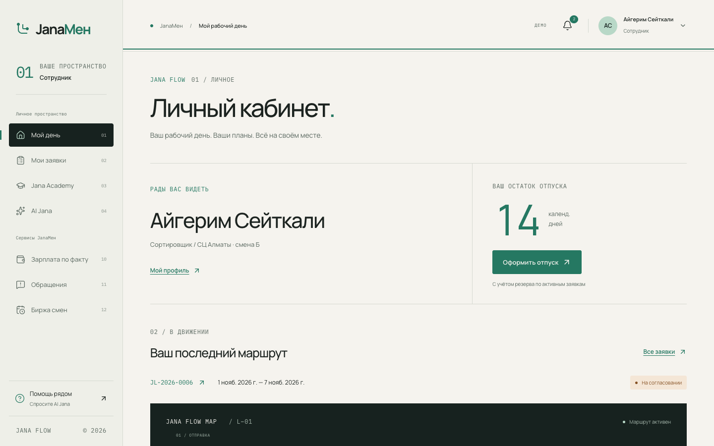
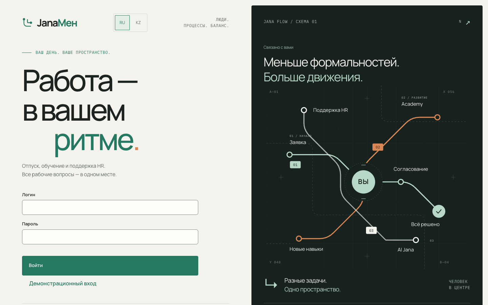
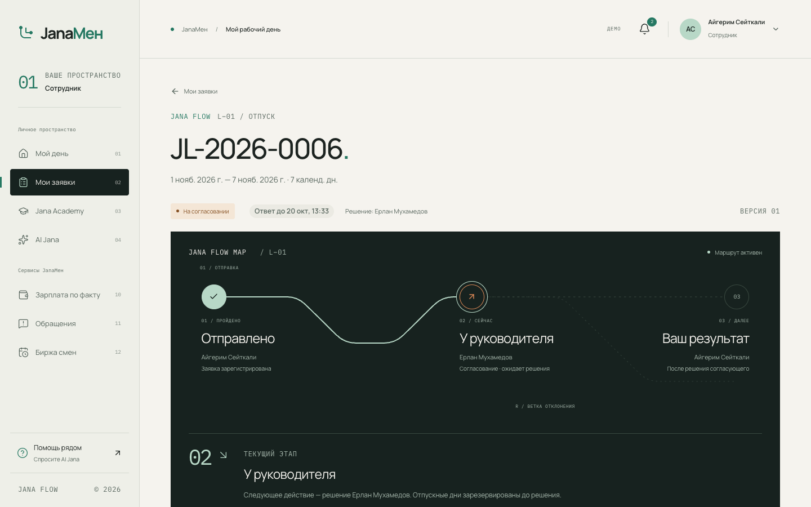
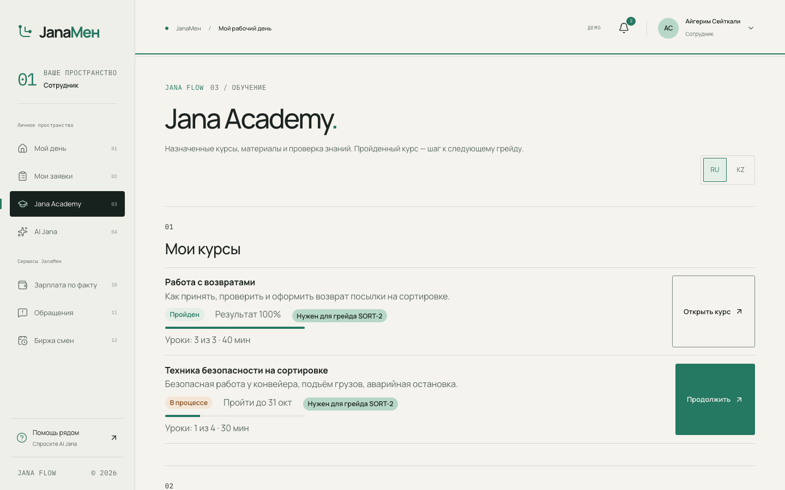
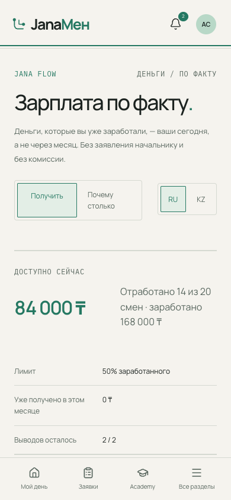
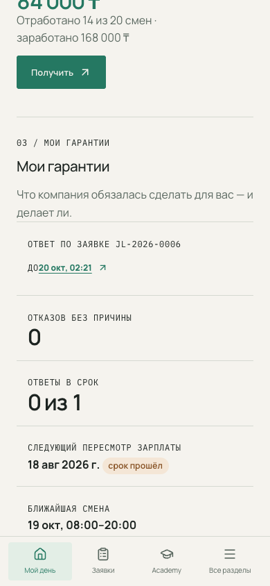
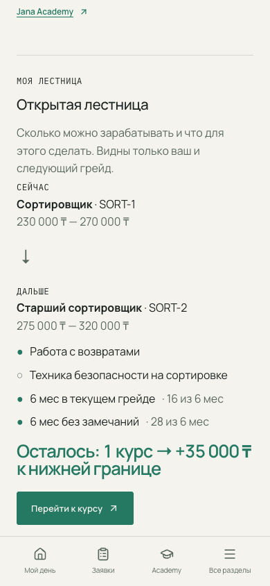
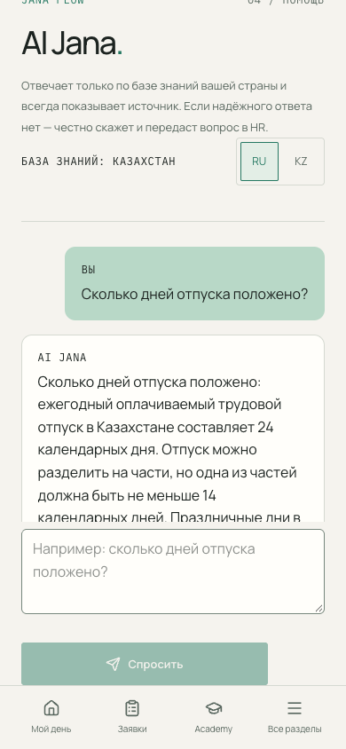
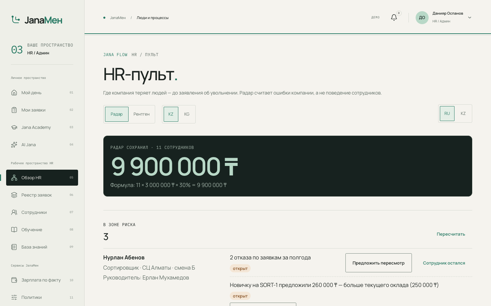
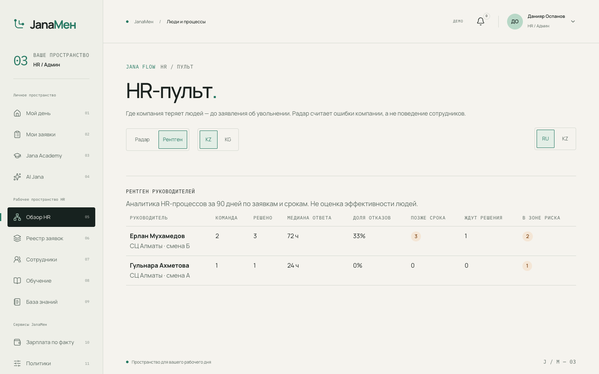

<div align="center">

# JanaМен

**HR-платформа для Jana Post: скорость гиг-платформы и стабильность штата — в одном приложении.**

Хакатон Jana Post × Terricon Valley · кейс Digital HR

**[Открыть онлайн-демо →](https://janamen.46.225.85.227.sslip.io)** · кнопка **DEMO** справа внизу — вход за любого персонажа

</div>



---

## Зачем это Jana Post

Jana Post за три года выросла до ~35% кросс-бордера Казахстана и 3 млн клиентов и выходит в новые страны.
За сортировщиков и курьеров компания конкурирует **не с другими логистами, а с Яндекс Про**: там деньги каждый день,
график без начальника и всё видно в приложении. В штате есть отпуск, больничный и рост, но деньги раз в месяц,
а решения — за начальником.

|  | Яндекс Про | Обычный штат | **JanaМен** |
|---|---|---|---|
| Деньги | каждый день | раз в месяц | **каждый день** — «Зарплата по факту» |
| График | сам решаешь | решает начальник | **меняешься сменами сам** — биржа смен |
| Прозрачность | всё в приложении | ничего не видно | **срок ответа и причина отказа видны** — гарантии |
| Отпуск, больничный | нет | есть | **есть** |
| Рост | нет | непонятно как | **виден путь и сумма** — открытая лестница |

**Каждая гарантия для сотрудника — это данные для руководства:** те же события питают HR-пульт, который показывает,
где компания теряет людей, до заявления об увольнении. Модель эффекта — ≈190 млн ₸ в год на 5 000 сотрудников
(формула и допущения — в [бизнес-модели](#бизнес-эффект)).

---

## Запуск за одну команду

Нужен **Docker** с Compose 2.24+ (Docker Desktop, OrbStack или Docker Engine). Больше ничего: ни Node, ни Python, ни `.env`.

```sh
git clone https://github.com/Mayntu/terricon_professors.git
cd terricon_professors
docker compose up
```

Через 1–2 минуты (первая сборка) всё готово, миграции и демо-данные применяются сами:

| Что | Адрес |
|---|---|
| Приложение | http://localhost:5173 |
| API и Swagger | http://localhost:8000/docs |

**Порт занят?** `DB_PORT=5433 API_PORT=8001 WEB_PORT=5174 docker compose up` — адрес API и CORS подстроятся сами.
**Сбросить демо-данные:** кнопка DEMO → «Сброс данных» или `curl -X POST http://localhost:8000/api/demo/reset`.
**Остановить:** `docker compose down` (данные сохраняются), `docker compose down -v` (с нуля).

### Как войти

- **Кнопка DEMO** (справа внизу) — вход за любого из 8 персонажей в одно нажатие, «+2 дня» (перевод времени для сроков), «Сброс данных».
- **Логин и пароль** на экране входа — пароль у всех `demo1234`.

| Логин | Кто | Что показывает |
|---|---|---|
| `aigerim` | Сотрудник, СЦ Алматы | Главный персонаж: «Зарплата по факту» 84 000 ₸, отпуск на согласовании, 1 из 2 курсов до следующего грейда |
| `nurlan` | Сотрудник | 2 отказа с причинами, вопрос к HR без ответа |
| `asel` | Сотрудник, другая смена | Её руководитель — не Ерлан: проверка «чужого сотрудника не видно» |
| `erlan` | Руководитель | Команда Айгерим и Нурлана, очередь согласований |
| `gulnara` | Руководитель | Пустые состояния: заявок и курсов нет |
| `daniyar` | HR | Реестр, сотрудники, радар удержания, политики, пробелы базы знаний |
| `bakyt` / `aibek` | Сотрудник / руководитель, Кыргызстан | Другая страна: свои сроки, лимиты и база AI |

Все люди и данные вымышленные.



---

## Кейс: обязательная часть

Всё из ТЗ кейса работает через интерфейс и проверено автотестами (чек-лист со ссылками на тесты — [`docs/CASE_CHECKLIST.md`](docs/CASE_CHECKLIST.md)).

| Требование ТЗ | Как сделано |
|---|---|
| **Единый вход и 3 роли** | Сотрудник, руководитель, HR. Меню и разделы зависят от роли; права проверяет **сервер** на каждом запросе — чужой сотрудник недоступен и в интерфейсе, и по прямой ссылке, и через API |
| **Личный кабинет** | ФИО, компания, должность, подразделение, руководитель, дата приёма, остаток отпуска (с учётом заявок на рассмотрении), назначенное обучение, уведомления. Данные читаются из 1С:ЗУП, менять их из приложения нельзя |
| **HR-сервис: отпуск и аванс** | Заявка на отпуск: проверка дат, остатка и пересечений, статус, история, решение руководителя, приказ в Documentolog. «Аванс» — это «Зарплата по факту» |
| **Мои заявки** | Все типы обращений в одном списке: тип, дата, статус, карточка с историей |
| **Jana Academy** | Каталог и назначенные курсы, уроки, тест с проходным баллом, прогресс и результат в профиле; назначение курсов руководителем и HR |
| **AI Jana** | Отвечает **только** по базе знаний своей страны и всегда показывает источник. Нет надёжного ответа — честно говорит и предлагает «Спросить HR». Вопросы о чужих данных — отказ без поиска |
| **Уведомления** | Смена статуса заявки, назначение и завершение курса, ответ HR; колокольчик и переход к нужному объекту |
| **RU / KZ** | Переключатель языка на входе и в меню профиля; уведомления и ошибки — на языке пользователя |
| **Интеграции** | 1С:ЗУП, Documentolog и банк — явные mock-адаптеры с местом подключения настоящих систем ([`docs/ARCHITECTURE.md`](docs/ARCHITECTURE.md)) |

<table>
<tr>
<td width="50%"></td>
<td width="50%"></td>
</tr>
<tr>
<td>Заявка: живой маршрут Jana Flow Map, срок ответа, история</td>
<td>Jana Academy: курсы, прогресс, бейдж «нужен для грейда»</td>
</tr>
</table>

---

## Наши фичи сверх кейса

### Для сотрудника

<table>
<tr>
<td width="25%"></td>
<td width="25%"></td>
<td width="25%"></td>
<td width="25%"></td>
</tr>
<tr>
<td><b>Зарплата по факту</b></td>
<td><b>Мои гарантии</b></td>
<td><b>Открытая лестница</b></td>
<td><b>AI Jana</b></td>
</tr>
</table>

- **«Зарплата по факту»** (Earned Wage Access). «Отработано 14 смен · заработано 168 000 ₸ · доступно 84 000 ₸» — получить в 3 нажатия
  от главной, без заявления начальнику. До 50% заработанного, 0 ₸ комиссии, не чаще 2 раз в месяц; заявка одобряется системой,
  заявление уходит в Documentolog, выплата — через банк. Вкладка «Почему столько»: смены, ночные, удержания и что останется к зарплате.
  Альтернатива сейчас — МФО.
- **Гарантии: права сотрудника — это код.** У каждой заявки срок ответа («Ответ до 20 окт»); руководитель не успел — заявка уходит в HR.
  Отклонить без причины из справочника и комментария нельзя — ни в интерфейсе, ни через API. Решение всегда принимает человек.
- **Открытая лестница.** Свой и следующий грейд с вилками, критерии (курсы, стаж, без замечаний) и итог: «Осталось 1 курс → +35 000 ₸
  к нижней границе». Курс из Academy засчитывается сразу. Чужие вилки и зарплаты не видны никому, кроме HR.
- **Биржа смен.** Отдать смену и взять смену коллеги в одно нажатие («+12 000 ₸»); система проверяет квалификацию и пересечения,
  двое не могут взять одну смену.
- **Обращения под стандарты ЕБРР.** Можно анонимно: автора не видит никто — ни руководитель, ни HR, ни радар.

### Для компании



- **HR-пульт: радар удержания и счётчик.** HR видит, кто может уйти и почему, **до заявления**: давно без пересмотра зарплаты,
  новичку предложили больше, отказы, медленные ответы, обращение без ответа. Радар ищет ошибки компании и **не** смотрит на выводы
  денег, вопросы к AI или поведение. «Предложить пересмотр» → уведомление сотруднику и новая дата в лестнице; «Сотрудник остался» →
  счётчик «Радар сохранил 12 человек = 10,8 млн ₸».
- **Рентген руководителей.** Медианное время ответа, доля отказов, решения позже срока, люди команды в зоне риска. HR видит всех,
  руководитель — только себя и своё место среди коллег.


- **Пробелы базы знаний.** Вопросы, на которые AI честно не ответил, группируются по смыслу (без имён). HR готовит черновик правила,
  правит и публикует — и AI сразу отвечает по нему с источником «Внутреннее правило».
- **Политики по странам.** Сроки ответа, лимиты «Зарплаты по факту», период пересмотра — свои для KZ и KG; новая страна подключается
  настройкой, а не разработкой.
- **Реестр, сотрудники, входящие HR.** Все заявки с фильтрами и историей, все сотрудники, ответы на обращения и вопросы из AI Jana.

---

## Бизнес-эффект

Осторожная модель на 5 000 сотрудников:

| Статья | В год |
|---|---|
| Текучесть сейчас: 2 000 уходов × 900 000 ₸ (замена — 30% годовой зарплаты) | 1,8 млрд ₸ |
| Удержание: −10% текучести (ниже, чем у поставщиков EWA: 27–35%) | **+180 млн ₸** |
| AI Jana закрывает 60% типовых вопросов HR | **+14,4 млн ₸** |
| Стоимость «Зарплаты по факту» (деньги в обороте ~10 дней) | −4,4 млн ₸ |
| **Итого** | **≈190 млн ₸ ≈ 38 млн ₸ на каждую 1 000 сотрудников** |

Допущения: зарплата 250 000 ₸/мес, текучесть линейного персонала 40%.

---

## Кто что сделал

| | Владислав Бондарев | Даниил Хуснуллин |
|---|---|---|
| **Зона** | Фронтенд и продуктовый дизайн | Бэкенд и ext-фичи |
| **Сделано** | Дизайн-система JANA FLOW и оболочка приложения; вход, главная, профиль, заявка на отпуск с живой картой маршрута Jana Flow Map, «Мои заявки», решения руководителя и HR, уведомления; перевод интерфейса на казахский; правила MVP (просрочка → HR, резерв дней); презентация с финальным роликом ([`presentation/`](presentation/README.md)) | FastAPI-бэкенд целиком: роли и права, движок заявок, Academy, AI Jana, интеграционные адаптеры; гарантии, «Зарплата по факту», лестница, HR-пульт, рентген, обращения, пробелы базы, биржа смен, политики; экраны этих фич и HTTP-слой фронтенда; деплой, автотесты и QA |

---

## Архитектура

```
Браузер ── React 19 SPA (Vite) ──HTTPS + JWT──► FastAPI ──► PostgreSQL 16
                                                   │
                                                   ├─ 1С:ЗУП       (mock, только чтение: оклад, табель, остаток отпуска)
                                                   ├─ Documentolog (mock: приказы и заявления)
                                                   ├─ Банк         (mock: выплаты)
                                                   └─ Anthropic    (по ключу; без ключа AI отвечает фрагментами базы)
```

| Слой | Технологии |
|---|---|
| Фронтенд | React 19, TypeScript 6 (strict), Vite 8, Tailwind 4, React Router 7, Motion, GSAP |
| Бэкенд | Python 3.12, FastAPI, SQLAlchemy 2 (async), Alembic, Pydantic v2 |
| Данные | PostgreSQL 16; миграции и демо-данные применяются при старте |
| AI | BM25 по базе знаний страны + Anthropic API (необязательно) |
| Запуск | Docker Compose; продакшн — nginx со статикой за Caddy ([`deploy/`](deploy/README.md)) |

Модули подключаются через точки расширения (события движка заявок, слоты интерфейса), каждая ext-фича выключается флагом
`EXT_FEATURES`. Подробно — [`docs/ARCHITECTURE.md`](docs/ARCHITECTURE.md), API — [`docs/API_CONTRACT.md`](docs/API_CONTRACT.md).

---

## Качество

| Проверка | Объём |
|---|---|
| Тесты бэкенда (pytest) | 378 |
| Сквозные проверки живого API на PostgreSQL (`backend/scripts/smoke_api.py`) | 113 |
| UI-тесты в браузере против реального бэкенда (`e2e-ext/`) — чек-лист кейса, демо-сценарий, устойчивость, безопасность ввода | 85 |
| UI-тесты фронтенда на mock-данных (`tests/`) | 26 |

Плюс прогон в Firefox и WebKit, проверка 1440 / 375 px на всех экранах и демо-сценарий защиты три раза подряд.
Итоги финальной проверки — [`docs/FINAL_QA.md`](docs/FINAL_QA.md).

```sh
cd backend && uv run pytest -q                              # тесты бэкенда
npx playwright test -c e2e-ext/playwright.config.ts         # UI-тесты против docker compose (сбрасывают демо-данные)
npm run check && npm run test:e2e                           # линтер, типы, сборка и тесты фронтенда на моках
```

---

## Реализовано · смоделировано · развитие

| | |
|---|---|
| **Реализовано полностью** | Вход и роли с проверкой прав на сервере; кабинет; отпуск, «Зарплата по факту», вопросы к HR и обращения на общем движке заявок со статусами, историей и защитой от двойной отправки; гарантии сроков и причин отказа; Academy; AI Jana с источниками и эскалацией; уведомления; лестница; HR-пульт, рентген, пробелы базы, биржа смен, политики KZ/KG; RU/KZ |
| **Смоделировано** | 1С:ЗУП, Documentolog и банк — mock-адаптеры (данные и документы тестовые, деньги не двигаются); демо-вход без пароля и «перевод времени» — только при `DEMO_MODE=true`; ставки удержаний в расчётке демонстрационные; автор анонимного обращения хранится в БД, чтобы видеть ответ, но не показывается никому |
| **Развитие** | Настоящие интеграции 1С:ЗУП (OData), Documentolog и банка-партнёра; SSO; биржа смен между центрами и странами; мобильное приложение; JanaМен для франчайзи |

---

## Документация

| Файл | О чём |
|---|---|
| [`backend/README.md`](backend/README.md) | Бэкенд: локальный запуск без Docker, флаги фич, демо-сценарий |
| [`docs/FRONTEND.md`](docs/FRONTEND.md) | Фронтенд: режим без бэкенда (моки), структура, motion, проверки |
| [`docs/DESIGN_SYSTEM.md`](docs/DESIGN_SYSTEM.md) · [`docs/SCREEN_MAP.md`](docs/SCREEN_MAP.md) | Дизайн-система JANA FLOW и карта экранов |
| [`docs/ARCHITECTURE.md`](docs/ARCHITECTURE.md) · [`docs/API_CONTRACT.md`](docs/API_CONTRACT.md) | Архитектура, места интеграций, все эндпоинты |
| [`docs/CASE_CHECKLIST.md`](docs/CASE_CHECKLIST.md) · [`docs/FINAL_QA.md`](docs/FINAL_QA.md) | Соответствие кейсу и финальная проверка |
| [`deploy/README.md`](deploy/README.md) | Деплой на сервер |
| [`docs/screenshots/`](docs/screenshots) | Скриншоты всех экранов (1440 и 375 px), шаги кейса — `case/` |
