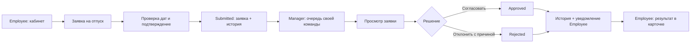
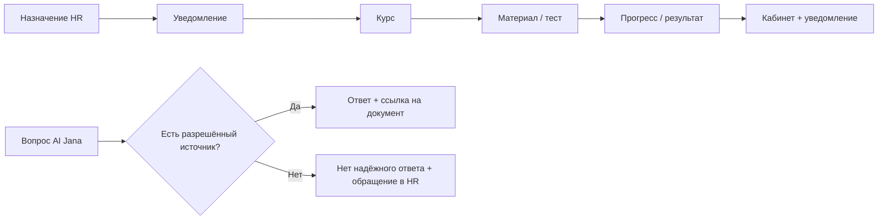

# JanaМен — карта экранов

Статус: запланированные продуктовые экраны. Сейчас `/` показывает техническую основу,
остальные адреса из `src/app/routes.ts` — общую заглушку; неизвестный URL — 404.
Данные, формы, сессия и проверка доступа отсутствуют. Role metadata документирует
будущую политику, но не исполняет её. `:id` — параметр, не адрес готовой записи.

## Основные маршруты

**Все** — Employee, Manager, HRAdmin со своей личной областью; **Manager** — только
разрешённая команда; **HRAdmin** — только назначенная область HR. Иерархия ролей
не предполагается: HRAdmin не получает произвольные права руководителя.

| URL | Экран | Роль / область | Основные переходы |
| --- | --- | --- | --- |
| `/` | Техническая основа | Публично, без данных | Статические заглушки |
| `/login` | Вход | Без сессии | Успех → `/dashboard`; ошибка → форма |
| `/dashboard` | Личный кабинет | Все / своё | Профиль, новая заявка, история, Academy, AI, уведомления |
| `/profile` | Профиль | Все / своё | Кабинет; кадровые поля read-only |
| `/requests` | Мои заявки | Все / своё | Новая заявка, карточка и история |
| `/requests/new/leave` | Оформление отпуска | Все / своё | Проверка → отправка → `/requests/:requestId` |
| `/requests/:requestId` | Заявка и история | Все / своё | Статус, история, возврат к списку |
| `/notifications` | Уведомления | Все / своё | Связанная заявка или курс |
| `/academy` | Jana Academy | Все / назначенное | Назначенный курс |
| `/academy/:courseId` | Обзор курса | Все / назначенное | Материал, продолжить, результат |
| `/academy/:courseId/lessons/:lessonId` | Материал / проверка знаний | Все / назначенное | Следующий материал или результат |
| `/academy/:courseId/result` | Прогресс и результат | Все / своё | Курс, Academy, кабинет |
| `/ai-jana` | HR-ассистент | Все / разрешённая база | Источник или обращение в HR |
| `/knowledge/:articleId` | Источник | Все / разрешённый документ | Назад к AI Jana |
| `/manager/team` | Моя команда | Manager / своя команда | Согласования; разрешённые сведения |
| `/manager/approvals` | Очередь согласования | Manager / своя команда | Решение по заявке |
| `/manager/approvals/:requestId` | Просмотр и решение | Manager / своя команда | Согласовать / отклонить с причиной → очередь |
| `/hr` | Рабочее пространство HR | HRAdmin / область HR | Реестр, сотрудники, обучение, знания |
| `/hr/requests` | Реестр заявок | HRAdmin / область HR | Подробности заявки |
| `/hr/requests/:requestId` | Обработка заявки | HRAdmin / область HR | История, состояние будущей интеграции |
| `/hr/employees` | Сотрудники | HRAdmin / область HR | Read-only сведения; детали в боковой панели |
| `/hr/learning` | Назначение обучения | HRAdmin / область HR | Назначение → уведомление сотруднику |
| `/hr/knowledge` | База знаний | HRAdmin / область HR | Документы, разрешённые источники AI |
| `/forbidden` | Нет доступа | Системный экран | Разрешённая область |
| `*` | 404 | Все | Основа; в продукте — кабинет |

После реализации кабинет займёт стартовую точку продукта; техническую страницу
убрать или вынести в dev-only preview по соответствующей задаче. HR-формы, контакт HR
и тестирование курса уточнить отдельно; не изобретать работающие операции.

## Главный сквозной сценарий

Для минимального демо согласование Manager завершает пользовательский путь.
HR-обработка и передача в Documentolog не становятся скрытым дополнительным
обязательным согласованием. При появлении такого требования расширить модель явно.

Локальное заполнение формы не равно созданной заявке. Отправка создаёт Submitted;
решения: Submitted → Approved или Submitted → Rejected. Причина отказа обязательна.
Cancelled зарезервирован для отдельного сценария отмены и пока не имеет команды/экрана.
Повторное решение и stale version дают conflict. Заявка, событие истории и уведомление
относятся к одной операции; атомарность обеспечивает backend, будущий demo-адаптер
воспроизводит её явно.

## Другие сценарии

## Системные состояния и доступ

- Без сессии → вход; прямой URL чужого объекта не даёт данные.
- Неподходящая роль/область → forbidden или согласованный not-found без раскрытия объекта.
- Каждый список: loading, empty, error/retry и успешное состояние.
- Форма: untouched, validation errors, submitting с защитой от повтора, success, conflict.
- При потере связи не показывать успешную отправку, решение или завершение курса.
- Notification ведёт к объекту с повторной проверкой доступа. Прочитано не равно удалено.
- История использует реальные события, не вымышленный анимированный прогресс.
- UI скрывает недоступные действия для понятности; backend проверяет роль, владение,
  принадлежность команде и каждый переход. Сейчас эти проверки не реализованы.

## Последовательность будущих этапов

1. Продуктовая оболочка, навигация и кабинет Employee.
2. Создание отпуска, список и история с явным demo-адаптером.
3. Manager: очередь, решение, результат и уведомления Employee.
4. Academy: курс, материал, прогресс, результат.
5. AI Jana: база знаний, источники и отсутствие ответа.
6. HR: реестр, сведения, назначения и знания.
7. ASP.NET Core + PostgreSQL и серверная авторизация отдельной задачей.

Это карта развития, а не разрешение реализовать следующие этапы автоматически.
